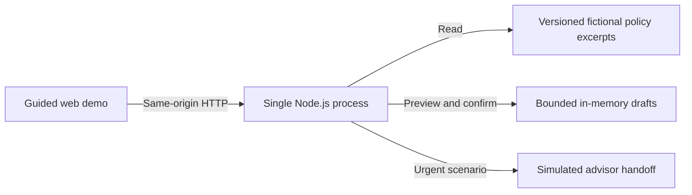

# Trabant Leap Agent POC architecture

The [Hack to Build concept](../idea/HTB-Idea-Review-Mobility-solution.md) describes a production target. This demo tests the interaction between grounded support and confirmed actions before adding live AI or enterprise integrations. It is fictional and not for real vehicle support.

| Production reference | POC boundary |
| --- | --- |
| Teams, web chat, dealer portal | One web UI with guided scenarios. There is no free-text or personal-data intake. |
| Foundry orchestration and Azure AI Search | Deterministic scenario routing. Each grounded answer quotes a bundled policy excerpt and links to its version. Unsupported guidance yields no answer or action. |
| API Management, Functions, and booking APIs | The server validates a fictional workshop and time slot, issues a short-lived draft, and accepts one explicit confirmation for that draft. No booking is sent. |
| Human advisor and safety policies | The urgent scenario returns a simulated handoff without a diagnosis or contacting anyone. This is not a general safety classifier. |
| Microsoft Entra and production governance | Local server binds to loopback by default. The Azure demo is intended for a restricted Entra audience; the app does not implement sign-in or audit customer activity. |

Pending drafts expire after ten minutes and are lost when the process restarts. Run one instance for the POC. There is no shared session data, external tool execution, persistent storage, or real customer data. `/healthz` measures liveness; `/readyz` checks that assets and fixture references are available.

## Demo walkthrough

The [recorded local walkthrough](./trabant-leap-agent-demo.webm) shows the cited warranty answer, the appointment preview and explicit confirmation, the simulated safety handoff, and the insufficient-evidence response.

The browser keeps the selected preset visible alongside the outcome. Citation links open the exact bundled excerpt and offer a return to the current response. Switching scenarios or resetting cancels pending browser requests and clears the current view; it does not undo a server response. If an appointment draft becomes invalid, the UI keeps the chosen workshop and slot but requires a fresh preview and opt-in. These interactions do not change the API contract or hosting topology.

## Azure deployment boundary

[Bicep](../infra/main.bicep) defines a single Linux App Service F1 instance and a dedicated user-assigned identity in Sweden Central. App Service terminates HTTPS and handles sign-in with a single-tenant Entra registration. Its authorization policy allows only the deploying user's Entra object ID. The managed identity supplies a federated client assertion instead of a secret. The hosting endpoint is network-reachable, not a private endpoint; the identity policy restricts access to the demo.

The [deployment script](../infra/deploy.ps1) checks that the live policy matches the intended audience before it publishes the app. Anonymous checks expose only health status, and ZIP deployment uses Entra rather than SCM passwords. The Node.js process has no application tokens, cloud data permissions, or real vehicle integrations. The UI sends a referrer only to its own origin so App Service can validate authenticated POST requests without weakening its cross-site request checks.

## POC exit checks

1. Show the exact versioned excerpt behind the warranty or maintenance answer.
2. Preview and explicitly confirm a fictional appointment; reject an unconfirmed, mismatched, or reused draft.
3. Show the simulated handoff and the insufficient-evidence outcome without fabricating guidance.
4. Verify the Azure deployment denies unsigned-in users and allows an approved tester before handing over the link.

All four checks passed at the previous Azure deployment. Anonymous requests to `/` and `/api/demo` returned `401`, both health routes returned `200`, and the approved test account completed the browser walkthrough. The one-user allowlist was verified in Azure configuration; a second signed-in account was not tested. The polished walkthrough was tested locally and is not a new Azure deployment.

Pilot business targets in the concept document are hypotheses, not demo results. Production work would require approved source data, broader safety evaluation, per-user authorization, durable idempotency and audit records, and the platform integrations in the [reference diagram](../idea/HTB-Idea-Architecture.png).
