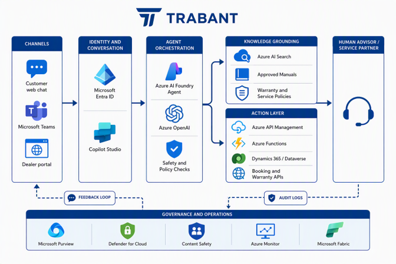

# Trabant Leap Agent

AI-powered service orchestration for a modern mobility company

*Hack to Build – Idea Submission Template (Sept 2026)*  
*Prepared on October 9, 2026*

> **Demo only:** This solution is for demonstration purposes only and is based on a fictional scenario.

## Executive summary

Trabant Leap Agent is a secure, reusable agentic solution that helps customers, dealers, and service teams resolve vehicle-support needs through one conversational entry point. It understands a request, grounds answers in approved company content, coordinates service systems, and keeps a human in control for sensitive or high-impact actions. The concept is designed as a practical hackathon prototype with a credible route to production and partner-led go-to-market.

## 1. Overview

Trabant is a fictional European mobility company that sells compact electric vehicles through a dealer and service-partner network. Leap Agent unifies fragmented owner support, workshop coordination, warranty guidance, and dealer knowledge into a single governed experience delivered through Microsoft Teams, web chat, and embedded customer channels.

## 2. Problem Clarity and Customer Relevance

Trabant customers and service partners currently navigate disconnected manuals, dealer portals, call centers, workshop systems, and warranty processes. A customer with a warning light or charging issue may repeat the same information several times, while an advisor manually searches documents, checks vehicle eligibility, identifies a workshop, and creates a case. The result is slow resolution, inconsistent advice, avoidable contact-center demand, and missed service revenue.

*Is the problem real, specific and worth solving for a named customer/partner scenario?*

*Clear problem statement, named persona/segment, evidence of pain — not a generic idea.*

## 3. Business Impact and Value Potential

*Size and credibility of the business or customer outcome (ACR, efficiency, revenue, adoption)*

*Quantified or credibly estimated outcome, clear beneficiary, line of sight to pipeline/co-sell.*

Illustrative pilot targets: reduce average support handling time by 25%, contain 35% of eligible informational requests without an advisor, achieve at least 85% grounded-answer acceptance in evaluation, and cut incomplete workshop handoffs by 30%. These are pilot hypotheses, not claimed results, and will be validated against baseline data.

### Business impact

- Customer experience: provide consistent, contextual answers at any time and reduce repeated explanations across channels.
- Operational efficiency: automate knowledge search, case preparation, routing, and appointment pre-processing so advisors focus on complex work.
- Service revenue: identify relevant maintenance and workshop opportunities while keeping recommendations transparent and policy compliant.
- Partner productivity: give dealers and workshops a shared, current source of approved product, warranty, and troubleshooting guidance.
- Insight: aggregate anonymized demand signals to reveal recurring product issues, content gaps, and service bottlenecks.

### Value proposition

- For customers: faster resolution, fewer handoffs, clear explanations, and easy access to an authorized human when needed.
- For contact-center teams: shorter research and documentation time with higher first-contact resolution.
- For dealers and workshops: better-qualified service requests and more complete case context before the customer arrives.
- For Trabant leadership: a measurable digital-service platform that improves experience while creating reusable intellectual property.

## 4. Innovation and Differentiation

*Originality vs. what already exists in-market or in Microsoft’s portfolio.*

*Genuinely innovative approach or meaningful improvement over existing tooling*

The innovation is not a generic chatbot. Leap Agent combines grounded conversational guidance with policy-aware workflow execution. It can move from explaining a dashboard warning to collecting consent, checking warranty context, locating an authorized workshop, proposing an appointment, and preparing a complete handoff. Its differentiator is the governed orchestration layer: every answer is grounded, every action is permission checked, and every sensitive decision can be escalated to a human.

## 5. Technical Feasibility and Architecture Approach

*Originality vs. what already exists in-market or in Microsoft’s portfolio.*

***Final Solution Requirement*** *- Technical decisions, appropriate technologies, scalability, path beyond the hackathon*

*Genuinely innovative approach or meaningful improvement over existing tooling*

***Final Solution Requirement*** *Deliberate, justified design; scales; realistic route to a real product.*

The solution is technically feasible because the prototype uses managed Microsoft services and narrow, well-defined tools. A Copilot Studio front end handles conversations, Azure AI Foundry provides model and orchestration capabilities, Azure AI Search supplies grounded retrieval, and secured connectors invoke Trabant business APIs. The architecture separates conversational reasoning from deterministic transactions, enabling independent scaling, testing, and governance.

| Layer | Microsoft capability | Purpose |
| --- | --- | --- |
| Experience | Copilot Studio, Teams, web channels | Conversation, authentication, multilingual delivery, human handoff |
| Agent and AI | Azure AI Foundry and Azure OpenAI | Planning, reasoning, tool selection, evaluation, model management |
| Knowledge | Azure AI Search | Permission-aware retrieval across manuals, policies, and service content |
| Actions | API Management and Azure Functions | Validated access to bookings, warranty, dealer, and case APIs |
| Business data | Dynamics 365, Dataverse, existing Trabant systems | Customer, vehicle, case, entitlement, and appointment context |
| Trust and operations | Entra, Purview, Content Safety, Defender, Azure Monitor, Fabric | Identity, compliance, protection, audit, quality, and analytics |

### Solution architecture

*Figure 1. Conceptual architecture for Trabant Leap Agent. Conversational reasoning is separated from permission-checked, deterministic business transactions.*

### Core architectural components.

Core components include customer and employee channels; Microsoft Entra ID and consent management; Copilot Studio for channel orchestration; an Azure AI Foundry agent for planning and tool selection; Azure AI Search for retrieval-augmented generation; API Management and Azure Functions for business actions; Dataverse or Dynamics 365 for cases and customer context; Fabric and Application Insights for analytics and observability; and Microsoft Purview, Defender for Cloud, and Content Safety for governance.

### Reference flow

A user submits a support request. The channel authenticates the user where required and sends the request to the conversational layer. The agent classifies intent, retrieves approved product and policy content, and produces a cited response. If an action is requested, the orchestration layer calls only approved tools through API Management. The transaction service validates identity, consent, policy, and business rules before updating the case, booking, or dealer system. Results and audit events are returned to the user, while low-confidence, safety-critical, or exceptional cases are routed to a human advisor.

## 6. Security, Governance, and Reliability Considerations

*Data handling, grounding, identity/access, privacy, RAI considerations*

*Sensitive data protected, access controlled, no secrets exposed, RAI risks acknowledged.*

Identity is enforced with Microsoft Entra ID, managed identities, least-privilege roles, and conditional access. Customer consent and data-minimization rules restrict which vehicle and profile data can be used. Grounding sources are curated, versioned, and access trimmed. Prompts and outputs are screened for unsafe content, prompt injection, and data leakage. Transaction tools require deterministic validation and confirmation before execution. All tool calls, citations, policy decisions, latency, failures, and human escalations are logged for audit and reliability management. Production deployment uses private networking, encryption, secretless authentication, retry and circuit-breaker patterns, regional recovery, and defined service-level objectives.

## 7. Microsoft Technology Alignment

*Fit with Azure AI, Copilot Studio, Foundry, agentic patterns and FY27 priorities.*

*Right Microsoft stack for the job, used purposefully — not bolted on.*

Leap Agent is purpose-built on the Microsoft stack. Copilot Studio accelerates multi-channel delivery and human handoff; Azure AI Foundry supports agent orchestration, evaluation, and model choice; Azure AI Search provides permission-aware grounding; Azure API Management and Functions expose controlled tools; Dynamics 365 and Dataverse manage customer and service records; Microsoft Fabric supports operational insight; and Entra, Purview, Defender, Azure Monitor, and Content Safety provide an integrated security and governance plane.

## 8. Reusability and GTM Potential

*Can this become reusable IP, a packaged offer or a marketplace solution?*

*Credible path to repeatable IP / GTM beyond a one-off demo*

The design separates Trabant-specific data, prompts, policies, and connectors from the reusable agent framework. This enables a packaged “Mobility Service Agent” offer for automotive manufacturers, fleet operators, equipment makers, and dealer networks. Reusable assets include reference architecture, connector templates, evaluation sets, safety policies, deployment automation, dashboards, and an implementation playbook. Go-to-market can combine partner implementation services, Azure consumption, Copilot Studio licensing, and optional Dynamics 365 expansion.

## 9. Suggested Pilot

Run an eight-week pilot with one vehicle model, two service partners, and a limited group of customers and contact-center agents. Focus on three journeys: warning-light guidance, warranty and maintenance questions, and workshop appointment preparation. Baseline current handling time and escalation rates, then measure answer groundedness, containment, task completion, time saved, customer satisfaction, unsafe-response rate, and human override frequency. Promote to production only after security review, red-team testing, operational readiness, and agreed quality thresholds.

### Pilot success criteria

- No critical safety or privacy violations in controlled testing.
- At least 90% of factual answers include an approved source citation.
- At least 80% task completion for the three scoped journeys.
- Human escalation occurs whenever confidence, policy, or safety thresholds require it.
- Positive advisor feedback on case completeness and time saved.

### Delivery roadmap

1. Weeks 1–2: confirm journeys, data access, baseline metrics, policies, and evaluation set.
2. Weeks 3–4: build grounded knowledge and read-only support experiences.
3. Weeks 5–6: add controlled case and appointment tools with confirmation and audit.
4. Weeks 7–8: conduct red-team, user acceptance, reliability, and value testing; produce scale recommendation.

## 10. Conclusion

Trabant Leap Agent addresses a specific, costly service problem with a realistic agentic architecture and a controlled path to value. The prototype can demonstrate end-to-end grounded support and safe workflow execution during the hackathon, while the modular design supports production hardening, reuse across mobility scenarios, and partner-led commercialization.
